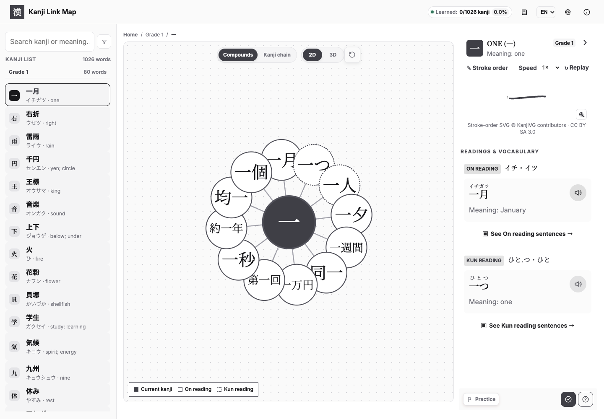
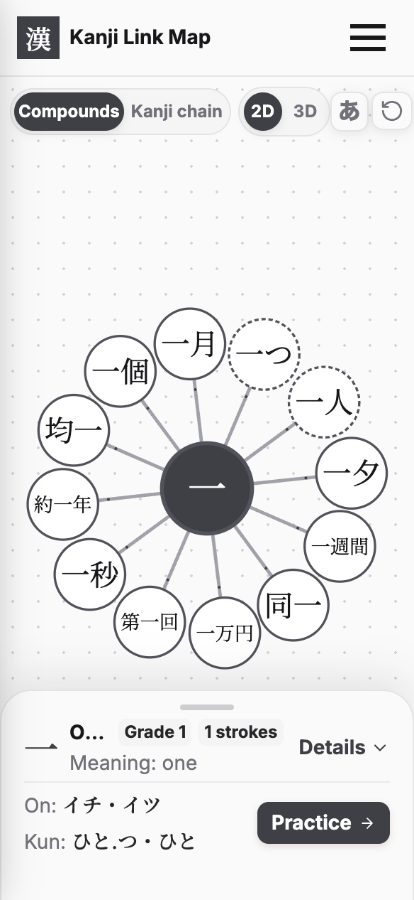

# CJKmap

### Chinese · Japanese · Korean Map

CJKmap is a visual hub for exploring Chinese, Japanese, and Korean writing systems through interactive maps. The Kanji Link Map is available now; the Hanzi and Hangul map destinations are coming soon.

## Kanji Link Map

[Open Kanji Link Map →](https://kanji.cjkmap.com)

Browse 1,026 school-grade kanji, search by character or meaning, and explore connections through compound and kanji-chain views. The map also includes 2D and 3D views, readings, meanings, vocabulary, and practice progress.

### Desktop

<a href="https://kanji.cjkmap.com">
  
</a>

### Mobile

<a href="https://kanji.cjkmap.com">
  
</a>

## About this repository

This repository contains the CJKmap landing page, a static site built with Vite and Three.js.

## Run locally

Requires Node.js 20.19+ or 22.12+.

```sh
npm ci
npm run dev
```

Create a production build with `npm run build`; Vite writes it to `dist/`.
